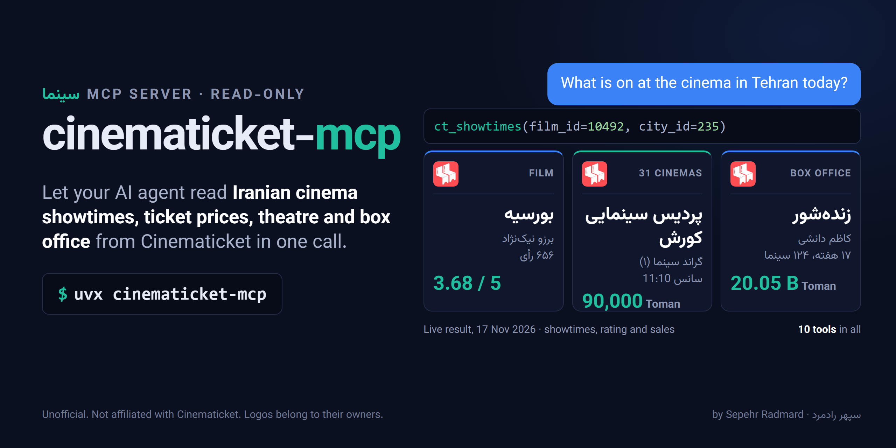

<!-- mcp-name: io.github.sepehr071/cinematicket-mcp -->

<div align="center">



# cinematicket-mcp: Cinematicket (سینماتیکت) Iranian cinema tickets MCP server for AI agents

**cinematicket-mcp is an unofficial, read-only MCP server that lets an AI agent read the programme of Cinematicket (سینماتیکت, cinematicket.org), the biggest Iranian cinema, theatre and concert ticket seller.**<br>
Its 10 tools list cities and cinemas, films with cast and rating, showtimes with ticket prices by city, cinema and date, theatre and concert listings, and the box office.<br>
No API key or account is needed; it works in Claude, Cursor, Copilot and any other MCP client.

[](https://pypi.org/project/cinematicket-mcp/)
[](https://pypi.org/project/cinematicket-mcp/)
[](https://github.com/sepehr071/cinematicket-mcp/actions/workflows/ci.yml)
[](https://github.com/sepehr071/cinematicket-mcp/blob/main/LICENSE)

[For AI agents](#for-ai-agents) · [Quick start](#quick-start) · [Tools](#tools) · [Limits](#limits) · [فارسی](#فارسی)

</div>

---

## For AI agents

- **What:** unofficial MCP server (model context protocol) for cinematicket.org: cities, cinemas of a city, one cinema's programme for a day, film detail (cast, director, genre, rating, sales), showtimes of a film by city, cinema and date with prices, theatre and concert listings, box office, search.
- **Install:** `uvx cinematicket-mcp` or `claude mcp add cinematicket -- uvx cinematicket-mcp`. Transport: stdio. Needs [uv](https://docs.astral.sh/uv/getting-started/installation/) (Python 3.10+).
- **Auth:** none. Optional `CINEMATICKET_MCP_PROXY` (HTTP proxy URL, or a comma-separated list); system proxy settings are ignored.
- **Access:** read-only. It cannot log in, hold or reserve seats, or pay, so no confirmation is needed before calling any tool.
- **Tools:** 10, all prefixed `ct_`. Typical sequences: `ct_cities` -> `ct_cinemas` -> `ct_cinema`; `ct_now_showing` / `ct_search` -> `ct_film` -> `ct_showtimes`; `ct_events` -> `ct_showtimes`; `ct_box_office`.
- **Use when:** the user asks what is playing, where and when a film or play is shown, ticket prices, which cinemas a city has, or the top-grossing films.
- **Do not use when:** the user wants to buy or reserve tickets, or needs seats left (the site shows them only in its seat map, which this server never opens).
- **Output:** compact JSON. Prices in Toman, times Tehran time, session dates Gregorian (YYYY-MM-DD). Names and summaries are Persian.
- **Machine-readable:** [`server.json`](https://github.com/sepehr071/cinematicket-mcp/blob/main/server.json).

## Quick start

You need [uv](https://docs.astral.sh/uv/getting-started/installation/). No API key or account.

Claude Code:

```bash
claude mcp add cinematicket -- uvx cinematicket-mcp
```

Claude Desktop, Cursor, VS Code and other clients:

```json
{
  "mcpServers": {
    "cinematicket": { "command": "uvx", "args": ["cinematicket-mcp"] }
  }
}
```

Example prompts:

- "What films are showing in Tehran today and what do tickets cost?"
- "Which cinemas does Shiraz have, and what is on at the best rated one?"
- "Which Iranian film has sold the most tickets this year?"
- <span dir="rtl">امروز در تهران چه فیلمی اکران است و بلیتش چند است؟</span>
- <span dir="rtl">پرفروش‌ترین فیلم‌های امسال کدام‌اند؟</span>

A real call on 17 Nov 2026: `ct_showtimes(film_id=10492, city_id=235)` returned 31 Tehran cinemas for «بورسیه» (rating 3.68 from 656 votes), for example پردیس سینمایی کورش at 11:10 for 90,000 Toman; `ct_box_office` listed «زنده‌شور» with 20,052,559,974 Toman in sales over 17 weeks in 124 cinemas.

## Tools

| Tool | What it does |
|---|---|
| `ct_cities` | Cities with ids |
| `ct_now_showing` | Films and shows on sale, by category (nationwide) |
| `ct_film` | Cast, director, genre, rating, summary, sales, how widely screened |
| `ct_cinemas` | Cinemas of a city with rating, address, facilities, coordinates |
| `ct_cinema` | One cinema's info and its programme for a day |
| `ct_showtimes` | Cinemas, halls, times and prices for a film, by city, cinema and date |
| `ct_upcoming` | Announced coming-soon films (often empty) |
| `ct_events` | Theatre plays, concerts or films with sessions |
| `ct_box_office` | Top films by total sales |
| `ct_search` | Find films, shows and cinemas by name |

## Limits

- Seats left are not public: the API gives `can_order` only, the seat plan is never opened, so the server cannot say how many seats remain.
- The site's film feed ignores the city argument, so `ct_showtimes` and `ct_cinemas` filter by city themselves; the first Tehran query needs about 12 requests (cached 10 minutes).
- `ct_now_showing` has no genres (the home feed omits them); use `ct_film` for genres.
- `ct_upcoming` is empty when the site lists no coming-soon films, and its non-empty shape is untested.
- No buying, reserving or login.

## How it works

Cinematicket has no public API. The site's own JSON endpoints were mapped in Chrome, and every tool was compared with the real rendered pages in Chrome on 2026-11-16 (values matched, see the map's test report). Requests use a Chrome-like TLS client, a short cache and a low request rate. The server ignores system proxy variables on purpose.

## فارسی

<div dir="rtl">

cinematicket-mcp یک سرور MCP غیررسمی و فقط‌خواندنی برای سینماتیکت (cinematicket.org) است. عامل هوش مصنوعی با آن شهرها و سینماها، فیلم‌ها با بازیگران و امتیاز، سانس‌ها و قیمت بلیت به تفکیک شهر و سینما و تاریخ، تئاتر و کنسرت و جدول فروش را می‌خواند. بدون کلید API و حساب کاربری کار می‌کند. خرید و رزرو صندلی ندارد و تعداد صندلی‌های خالی را نشان نمی‌دهد. نصب در Claude Code:

</div>

```bash
claude mcp add cinematicket -- uvx cinematicket-mcp
```

## Development

```bash
uv sync
uv run ruff check . && uv run ruff format --check .
uv run python -m pytest -q          # offline tests on trimmed fixtures
uv run python -m pytest -m live -q  # live calls to cinematicket.org
```

Releases: bump the version in `pyproject.toml` and `server.json`, run `uv lock`, then push a `v*` tag; GitHub Actions publishes to PyPI.

## Disclaimer

Unofficial: not affiliated with, endorsed by or sponsored by Cinematicket. Data and logos belong to their owners.

Author: Sepehr Radmard (سپهر رادمرد), [github.com/sepehr071](https://github.com/sepehr071) · [linkedin.com/in/sepehr-radmard](https://www.linkedin.com/in/sepehr-radmard)

## Related servers

More Iranian-site MCP servers (shops, travel, news, finance, jobs, maps): [github.com/sepehr071/iran-mcp](https://github.com/sepehr071/iran-mcp).
